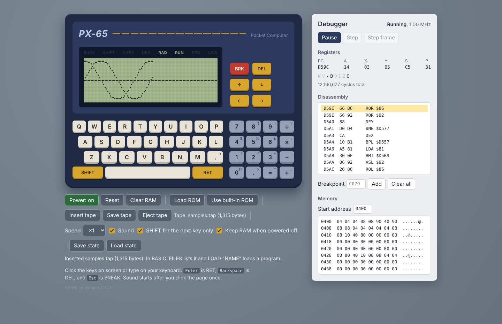
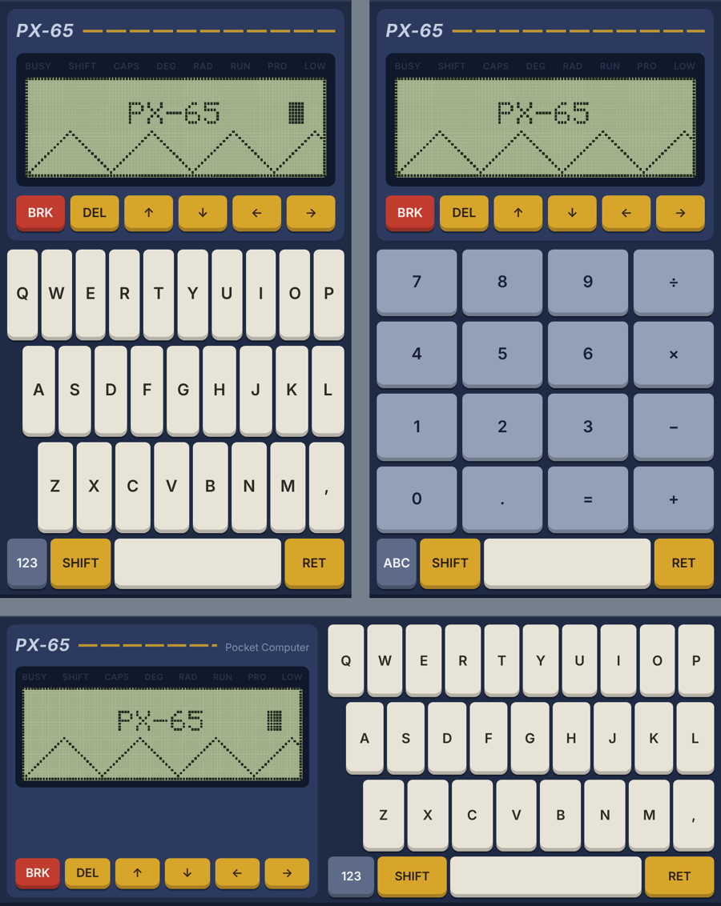

# PX-65

[日本語](README.md) | English

An emulator for the PX-65, an imaginary pocket computer built around the 65C02. See `docs/PX-65_spec.md` for the hardware specification (Japanese only).

**Play it in your browser: https://ocllorunner-ai.github.io/px65/** (just open the URL, on a computer or a phone)

**New to the PX-65? Start with `docs/guide.en.md` (Getting Started).** Ready-to-play sample programs are in `samples/samples.tap` (choose it with **Insert tape**, then type `FILES`, `LOAD "NAME"`, `RUN`).



## Try it now

Open https://ocllorunner-ai.github.io/px65/ and choose **English** or **日本語**. Or download `dist/px65-en.html` (English) or `dist/px65.html` (Japanese) and double-click it. Nothing to install and no server needed.

- Click the keys on screen or type on your keyboard (Enter is RET, Backspace is DEL, Esc is BREAK)
- The on-screen SHIFT key applies to the next key only. Uncheck **SHIFT for the next key only** to make it work only while held down (the setting is remembered)
- Sound starts after you click the page once (browsers don't allow sound before you interact with the page)
- **Load ROM** loads your own ROM (a .bin of 24KB or less). The loaded ROM is used again the next time you open the page
- **Save state** / **Load state** keep one saved state in the browser
- **Keep RAM when powered off** is on from the start, so your program stays when you turn the power off or open the page again. To erase everything, press **Clear RAM**
- **Insert tape**, **Save tape** and **Eject tape** move the virtual tape to and from files. In BASIC, use `SAVE "NAME"`, `LOAD "NAME"` and `FILES`. The tape is still there the next time you open the page
- The built-in ROM contains BASIC and a monitor. BASIC starts at power-on. It has floating point (9 significant digits), trigonometric, exponential and logarithmic functions, string functions, graphics (PSET, LINE, CIRCLE), sound, saving to tape by name, renumbering (RENUM), and a calculator mode (CALC) that shows the answer to an expression without `PRINT`. See `docs/basic.en.md`
- Type `MON` in BASIC to enter the monitor (`Q` goes back). It can view and change memory, assemble and disassemble, run programs, set breakpoints, and step one instruction at a time. See `docs/monitor.en.md`

```
PX-65 BASIC 0.11
30717 BYTES FREE
>10 FOR X=0 TO 95
>20 PSET X,16-14*SIN(X*PI/48)
>30 NEXT
>RUN
```

The small characters in the top-right corner of the on-screen keys are what the key gives with SHIFT (`:` is SHIFT+×, `;` is SHIFT++, `^` is SHIFT+=). On a computer keyboard, just type the symbol.

### Phones



- The whole unit fits on one screen, held upright or sideways. Sideways, the LCD is on the left and the keyboard on the right
- The **123** and **ABC** keys switch between the number keys and the letter keys (both upright and sideways)
- Open the debugger with **Show debugger**
- On devices that can vibrate (mostly Android), keys give a short vibration. **Vibrate on key press** turns it on and off, and the setting is remembered. iPhone browsers don't support vibration, so the setting isn't shown there
- iPhones make no sound in silent mode
- Phones often can't open a downloaded HTML file directly. Open https://ocllorunner-ai.github.io/px65/ by its URL instead

## Status

- [x] 1. CPU core (`src/cpu65c02.js`)
- [x] 2. Memory map and I/O (`src/bus.js`, `src/machine.js`)
- [x] 3. Keyboard, timer, buzzer
- [x] 4. Browser UI (`web/`, `dist/px65.html`)
- [x] 5. ROM (monitor) (`rom/monitor.s`, manual: `docs/monitor.en.md`)
- [x] 6. Virtual tape (`src/bus.js`, the UI, the monitor's W and L)
- [x] 7. Monitor assembler (the A command)
- [x] 8. BASIC (`rom/basic*.s`, manual: `docs/basic.en.md`)

## Files

| Path | Contents |
| --- | --- |
| `src/cpu65c02.js` | WDC 65C02 CPU core |
| `src/bus.js` | Memory map, I/O registers, LCD rendering |
| `src/machine.js` | Connects the CPU and the bus. Runs frame by frame; saves and restores state |
| `src/disasm.js` | Disassembler (for the debugger) |
| `web/index.html` | UI HTML and CSS (template used by the build) |
| `web/home.html` | Template for `dist/index.html`, the entrance to the published site (choose Japanese or English) |
| `web/ui.js` | UI (keyboard, LCD, sound, controls, debugger) |
| `web/keyqueue.js` | Applies key presses and releases to the key matrix at intervals the ROM won't miss |
| `web/i18n.js` | UI text (Japanese and English) |
| `tools/build.js` | Bundles everything into one file, in Japanese and English versions. Also makes `dist/index.html`, the entrance to the published site |
| `.github/workflows/pages.yml` | On GitHub, runs `npm test` (Node 18 and 24) on every push to main, and publishes `dist/` to GitHub Pages if it passes |
| `tools/asm.js` | 65C02 assembler |
| `tools/rom.js` | Assembles BASIC (`$A000-$DFFF`) and the monitor (`$E000-$FFFF`) into the built-in ROM `rom/px65.bin` |
| `tools/mkfont.js` | Generates the monitor's font (`rom/font.s`) |
| `tools/mkoptable.js` | Generates the monitor disassembler's opcode table (`rom/optable.s`) from the CPU core's table |
| `tools/mkfpconst.js` | Generates BASIC's floating-point constants and polynomial coefficients (`rom/basic_const.s`) |
| `tools/mksamples.js` | Builds the sample tape (types each program into BASIC and SAVEs it) |
| `tools/screenshot.js` | Runs a ROM and writes the screen to a PNG |
| `tools/coverage.js` | Finds the ROM instructions and branches the tests never ran (`npm run coverage`) |
| `test/fuzz.js` | Tries BASIC with random input (`npm run fuzz`) |
| `test/fuzz_gen.test.js` | Checks that the programs made by the fuzzer's prog kind are shaped so that they always end, and that the machine-code programs made for the mon kind's G, T and P always stop inside their own areas |
| `test/fuzz_mon.js`, `test/fuzz_mon_run.js`, `test/fuzz_input.js`, `test/fuzz_files.js` | The fuzzer's mon (monitor; G, T and P are in `fuzz_mon_run.js`), input (INPUT) and files (FILES) kinds, loaded by `test/fuzz.js` |
| `test/basic_math.test.js` | Compares BASIC's math functions with JavaScript's calculation (`npm run mathcheck`) |
| `rom/px65.inc` | Definitions shared by the monitor and BASIC (I/O, BIOS addresses, work areas) |
| `rom/monitor.s` | Monitor and BIOS. Includes `rom/font.s` and `rom/optable.s` |
| `rom/basic.s` | BASIC. Includes `basic_main.s` (line input, execution), `basic_expr.s` (expressions, variables), `basic_str.s` (strings), `basic_stmt.s` (commands), `basic_io.s` (graphics, sound, tape), `basic_math.s` (math functions), `basic_fp.s` (floating point) and `basic_const.s` |
| `rom/px65.bin` | Built-in ROM (BASIC + monitor, 24KB) |
| `rom/test_pattern.s` | Test ROM |
| `docs/guide.en.md` | Getting Started (startup, typing, programs, tape, samples, troubleshooting) |
| `docs/basic.en.md` | BASIC manual |
| `docs/monitor.en.md` | Monitor manual (commands, BIOS routines, memory map) |
| `docs/PX-65_spec.md` | Hardware specification (Japanese only) |
| `docs/ui-en.png` | Screenshot of the English UI (used in this README) |
| `samples/*.bas` | Sample programs (text) |
| `samples/samples.tap` | Tape with all the samples (built from `samples/*.bas` by `npm run samples`) |
| `dist/px65.html` | Built emulator (Japanese) |
| `dist/px65-en.html` | Built emulator (English) |
| `dist/index.html` | Entrance to the published site (choose Japanese or English) |
| `test/` | Tests (`test/watch.js` watches what the ROM does and records coverage) |

The Japanese documents have the same names without `.en` (`README.md`, `docs/guide.md`, `docs/basic.md`, `docs/monitor.md`).

Everything runs with Node.js 18 or later, with nothing else to install.

## Development

```sh
npm test              # all tests (CPU interrupts, assembler, bus, run-time watch, monitor, floating point, math functions, BASIC, key input, samples, the fuzzing tool, a little fuzzing, distributed files)
npm run coverage      # write the ROM instructions and branches the tests never ran to coverage/report.txt
npm run fuzz          # try BASIC with random input (fuzzing; see below)
npm run mathcheck     # check the error of the math functions on many cases (see below)
npm run rom           # build the built-in ROM rom/px65.bin (generates the font, opcode table and constants, then assembles)
npm run monitor       # build the monitor-only ROM rom/monitor.bin
npm run build         # rebuild the three files in dist/ with rom/px65.bin as the built-in ROM (run after changing src/, web/ or the ROM)
npm run samples       # build samples/samples.tap from samples/*.bas (run after changing the samples or the ROM)
npm run testpattern   # assemble the test ROM
npm run screenshot    # save BASIC's startup screen to docs/basic.png
npm run screenshot:monitor      # save the monitor's startup screen to docs/monitor.png
npm run screenshot:testpattern  # save the test ROM's screen to docs/test_pattern.png
```

When you push to main on GitHub, GitHub Actions (`.github/workflows/pages.yml`) runs `npm test` and, if it passes, publishes `dist/` to the site. `npm test` also checks that `dist/` matches a fresh build from the sources, so if you forget `npm run build`, nothing is published. Pull requests are only tested.

To build with a different built-in ROM, use `node tools/build.js --rom <ROM.bin>` (without `--rom`, the test ROM is used).

The BASIC tests boot the ROM with `test/basic_harness.js`, put lines into the key buffer, and check the characters printed.

The tests that run the ROM are watched by `test/watch.js`. If the ROM code does any of the following, the test fails (at the end it prints `WATCH` lines with the source file and line):

- Executes the middle of an instruction or data, or executes BRK, STP or an undefined opcode inside the ROM
- Writes to RAM it does not own (see "Memory map" in `docs/basic.en.md` and `docs/monitor.en.md`), to the ROM, or to an undefined I/O address. Things where the user chooses the address, such as POKE, CALL and the monitor's E, F and M, are excepted
- Leaves the ROM other than by RTS or RTI (except CALL and the like), or the stack pointer wraps around
- While BASIC waits for input at the prompt, the program's line links or the memory records such as `vartab` do not agree

`npm run coverage` runs all the tests with the watch and writes to `coverage/report.txt`, by source line, the ROM instructions that never ran and the conditional branches that went only one way (`coverage/` is not distributed). Use it as a guide when adding tests.

`npm run fuzz` types randomly generated input into BASIC with the watch attached (`test/fuzz.js`). It checks that BASIC always comes back, that the watch reports nothing, and that every error is a known one. There are seven kinds:

- `expr`: random expressions run directly with `PRINT` or an assignment (sometimes with one character broken). After each line it also checks that the bytes of a sentinel line (`1 REM SENTINEL`) and the string `Z$` are unchanged
- `prog`: random programs built so that they always end (the main part and the subroutines are kept apart, jumps only go to later lines, and subroutines hold only simple statements so they always reach `RETURN`; `test/fuzz_gen.test.js` checks these rules on generated programs without running them). After every `RUN` it checks that every byte of the program is unchanged. It also checks that the output stays the same when you `RUN` again, retype what `LIST` shows and `RUN` (and the retyped bytes are the same), `RENUM` and `RUN` (with the line numbers in `IN` matched up), and `SAVE`, `NEW`, `LOAD` and `RUN` (and the loaded bytes are the same). The screen (VRAM) after the second `RUN` and after retyping is compared with the first one, and the screen after `LOAD` is compared with the one after `RENUM` (if the program shows no line numbers on the screen, the one after `RENUM` is also compared with the first)
- `edit`: repeatedly adds, replaces and deletes lines, uses `DELETE` and creates variables, and checks that `LIST` shows each line exactly as typed and that deleted lines are gone
- `keys`: random keys mixed with ← → ↑ ↓ DEL, typed at the prompt, in calculator mode and inside `EDIT`
- `mon`: enters the monitor with `MON` and types random command lines (correct ones and slightly broken ones) and keys for D, U and E (`test/fuzz_mon.js`). The memory written by E, F, M, A and L, and the output of H, S, C, B, R, D, W and L, are compared with a JavaScript model. A types lines made from the opcode table and compares the bytes written with those worked out by the manual's rules. U checks that typing the shown lines back into A at the same address gives the same bytes. G, T, P and B run random machine-code programs written with E (`test/fuzz_mon_run.js`). The programs are built so that, whatever path they take, they only read and write their own areas and always stop; they include branches, loops, subroutines, the stack, `JMP (address)` and jumps made with RTS and RTI, and they end with RTS, BRK or a jump to itself. The registers shown at each stop are compared with a model that runs the program on the same CPU core, and the memory is checked to be as before, with no BRK left behind. When the program loops on a jump to itself, it presses BREAK. It also steps instructions that go to the monitor's addresses (`$00E0-$057F`) with T and P, and checks that they give `?` without writing anything, and that nothing is written back after a later G. At the end it goes back to BASIC with `Q` and checks that the program and variables are still there
- `input`: types random answers into `INPUT` programs (numbers, hex, non-numbers, strings with and without quotes, too few or too many items, empty lines and so on) (`test/fuzz_input.js`). Everything shown on the screen, from `? `, `?? `, `?REDO` and the echo of the typed lines to the values printed at the end, is compared with a model. It sometimes presses BREAK too
- `files`: types `FILES` with a tape of random blocks (some cut short or broken) and presses keys at the page waits (`test/fuzz_files.js`). The list is compared with a model that reads the tape bytes

Before every case the power is turned on again with the same setup, so a case starts from the same state whether it runs in a batch or alone with `--case`.

```
npm run fuzz                                   # seed from the clock; 200 cases of each kind
npm run fuzz -- --seed 123 --count 1000        # choose the seed and the number of cases
npm run fuzz -- --kind prog,edit               # choose the kinds
npm run fuzz -- --seed 123 --case prog:17 --verbose   # redo one failed case, showing every line typed and every output
```

On a failure it shows the kind, the case number, the lines typed and the reason. The same seed and number redo the same input. With `--repro-check`, after the batch it runs the first 3 cases of each kind again one by one in reverse order and checks that everything typed and shown (including the keys and the output along the way in `keys`) and the final RAM are the same. `npm test` runs 10 cases of each kind with seed 1 and `--repro-check`.

`test/basic_math.test.js` calls the ROM routines directly and compares BASIC's math functions (`SQR`, `EXP`, `LN`, `LOG`, `SIN`, `COS`, `TAN`, `ATN`, `^`), reading numbers (`VAL`) and printing them (`STR$`) with JavaScript's double-precision calculation. It measures the error in ulp (the size of the lowest bit of the mantissa), and fails when a function goes over its limit (the accuracy given under "Speed and limits" in `docs/basic.en.md`). It also checks exact values (`SIN(90)` is 1 in degrees, and so on), where errors start, and the displayed text. `npm test` runs 200 cases of each item with seed 1. `npm run mathcheck` runs with another count and seed, and shows the distribution of errors and the worst case for each item.

```
npm run mathcheck -- --count 5000 --seed 2     # 5000 cases of each item (about 3 minutes)
npm run mathcheck -- --only POW --count 20000  # only the items whose name contains POW
```

`test/dist.test.js` checks that `rom/px65.bin`, `rom/monitor.bin`, `samples/samples.tap` and the two files in `dist/` match what the sources build. After changing the sources, run `npm run rom`, `npm run monitor`, `npm run samples` and `npm run build`, then `npm test`.

### Changing UI text or adding a language

All UI text is in `web/i18n.js`. HTML uses it as `{{key}}`, and `web/ui.js` as `t('key')`. To add a language, add a table to `web/i18n.js` with every key that `ja` has, and add its output file name to `LANGS` in `tools/build.js`. The build stops with an error if a key is missing.

The Japanese and English versions share browser storage (the loaded ROM, saved state and RAM).

### Assembler

```sh
node tools/asm.js <source.s> -o <out.bin> --range A000:FFFF -l <listing.lst>
```

See the comment at the top of `tools/asm.js` for the syntax. It supports labels, constants (`NAME = expression`), `.org`, `.byte`, `.word`, `.fill`, `.include`, and expressions (`<` `>` for the low and high byte). Symbol names are not case-sensitive.

### The emulator itself

```js
import { Machine } from './src/machine.js';

const m = new Machine();
m.loadROM(romBytes);    // ROMs smaller than 24KB are aligned to the end
m.powerOn();            // { keepRAM: true } keeps RAM
m.runFrame();           // run 1/60 second (about 16,667 cycles)
m.bus.renderLCD();      // 96×32 dots (1 = on)
m.bus.setKey(row, col, true);  // press a key
m.pressBreak();         // BREAK key (NMI)
m.bus.beepEvents;       // cycles at which the buzzer changed
```

## CPU tests

The CPU core is checked with Klaus Dormann's four 6502/65C02 tests (downloaded separately).

```sh
git clone https://github.com/Klaus2m5/6502_65C02_functional_tests.git ../6502tests
npm run test:cpu -- ../6502tests
```

| Test | What it checks | Result (2026-10-22) |
| --- | --- | --- |
| `6502_functional_test.bin` | Every 6502 instruction and addressing mode, decimal mode | Pass (about 30.6 million instructions) |
| `65C02_extended_opcodes_test.bin` | Instructions added in the 65C02, RMB/SMB/BBR/BBS, undefined opcodes acting as NOPs (WAI/STP are not tested with this test's settings) | Pass (about 22 million instructions) |
| `6502_decimal_test.a65` | Decimal-mode ADC/SBC for every combination, including invalid BCD; A and the N V Z C flags checked against 65C02 behavior | Pass |
| `6502_interrupt_test.a65` | Accepting IRQ, NMI and BRK, the flags pushed on the stack, and D being cleared by interrupts (the automatic part; the manual WAI/STP tests after it are not run) | Pass |

- WAI and STP are tested by this project's own `test/interrupts.test.js` (part of `npm test`): WAI waiting and resuming on IRQ, STP stopping, and so on
- Tests 1 and 2 run the prebuilt binaries with `test/functional.js`
- Tests 3 and 4 are distributed only as source for the as65 assembler, so `test/as65.js` converts them to `tools/asm.js` syntax and `test/decimal.js` and `test/interrupt.js` run them. For test 4, the port the test uses to raise interrupts is placed at `$BFFC` (it exists only for the test, not in the PX-65 itself)
- Tests 3 and 4 were also confirmed to fail when deliberate errors are put into the CPU core (decimal adjustment, the V flag, the D flag on interrupts, the I flag, BRK's B flag, NMI, etc.)

## Versions

The emulator and the built-in ROM have separate version numbers.

| | Current version | Where it is shown | Where it is set |
| --- | --- | --- | --- |
| Emulator | 0.11.20 | At the bottom of the page (`PX-65 emulator v0.11.20`), and in the comment at the top of the distributed HTML | `version` in `package.json` (inserted by the build) |
| Built-in ROM | 0.11 | BASIC's startup screen (`PX-65 BASIC 0.11`), and the startup screen of the monitor-only ROM (`V0.11`) | `b_banner` in `rom/basic_main.s`, and `rom/monitor.s` |

For the emulator, bug fixes raise the third number and new features raise the second. The ROM version has only two numbers (so that it fits on one line of the startup screen), and new features raise the second. Bug fixes in the ROM show up in the third number of the emulator, which contains the built-in ROM. Both become 1.0 when the project is finished.

## License

This project (the emulator, the built-in ROM's BASIC and monitor, the tools, the tests and the documents) is dedicated to the public domain under CC0 1.0 Universal. The full text is in `LICENSE`.

- Anyone may use, modify, distribute and sell it without permission. No credit is required
- No warranty. The authors are not responsible for anything that results from using it
- In countries where rights can't be fully waived (such as Japan), the remaining rights are licensed to everyone without conditions (section 3 of CC0)

Klaus Dormann's CPU tests (GPL 3.0) are not part of this project. Download them separately as shown above.
