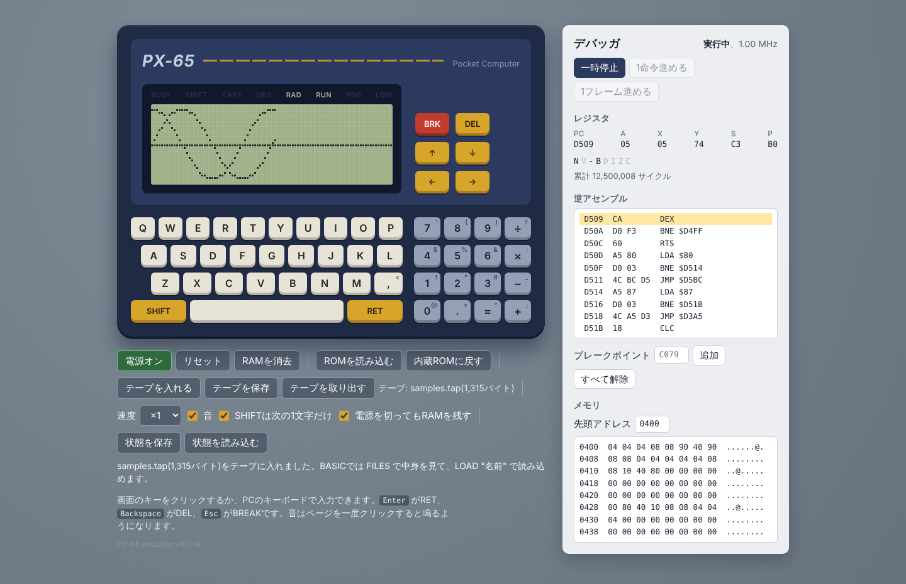
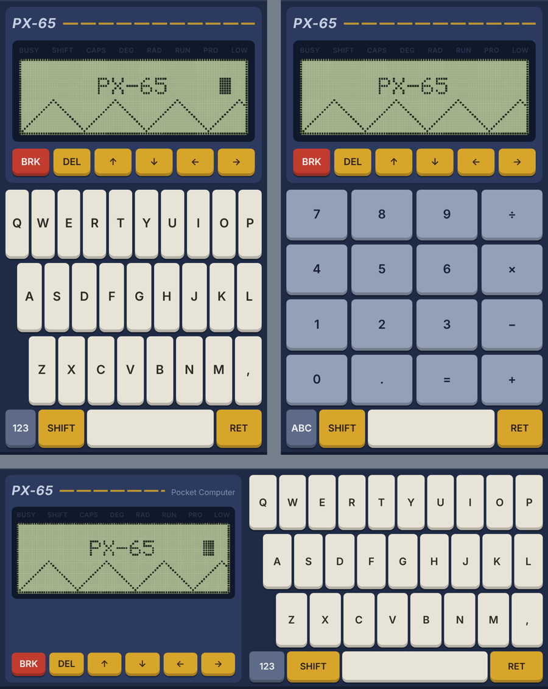

# PX-65

日本語 | [English](README.en.md)

65C02を搭載した架空のポケコン「PX-65」のエミュレーター。仕様は `docs/PX-65_spec.md` を参照。

**はじめて使うときは `docs/guide.md`(はじめてガイド)を読む。** すぐに遊べるサンプルのプログラムが `samples/samples.tap` にある(「テープを入れる」で選び、`FILES`、`LOAD "名前"`、`RUN`)。



## すぐに試す

`dist/px65.html`(日本語版)か `dist/px65-en.html`(英語版)をダブルクリックしてブラウザで開くだけで動く。インストールもサーバーも要らない。

- 画面のキーをクリックするか、PCのキーボードで入力する(EnterがRET、BackspaceがDEL、EscがBREAK)
- 画面の SHIFT キーは、押すと次の1文字だけ効く。「SHIFTは次の1文字だけ」のチェックを外すと、押している間だけ効く方式になる(設定は次回も残る)
- 音はページを一度クリックすると鳴るようになる(ブラウザの決まりで、操作するまで音を出せないため)
- 「ROMを読み込む」で自作のROM(24KB以下の .bin)を読み込める。読み込んだROMは次に開いたときも使われる
- 「状態を保存」「状態を読み込む」はブラウザ内に1つだけ保存する
- 「電源を切ってもRAMを残す」は初めからオンで、電源を切ってもページを開き直してもプログラムが残る。全部消したいときは「RAMを消去」
- 「テープを入れる」「テープを保存」「テープを取り出す」で仮想テープをファイルと行き来させる。BASICでは `SAVE "名前"`、`LOAD "名前"`、`FILES`。テープの中身は次に開いたときも残る
- 内蔵ROMは BASIC とモニター。電源を入れると BASIC が起動する。浮動小数点(有効数字9桁)、三角関数・指数・対数、文字列関数、グラフィック(PSET、LINE、CIRCLE)、音、テープへの名前付き保存、行番号の振り直し(RENUM)、`PRINT` なしで式の答えを出す計算モード(CALC)が使える。使い方は `docs/basic.md`
- BASIC で `MON` と打つとモニターに入る(`Q` で戻る)。メモリの表示と書き込み、アセンブルと逆アセンブル、プログラムの実行、ブレークポイント、1命令ずつの実行ができる。使い方は `docs/monitor.md`

```
PX-65 BASIC 0.11
30717 BYTES FREE
>10 FOR X=0 TO 95
>20 PSET X,16-14*SIN(X*PI/48)
>30 NEXT
>RUN
```

画面のキーの右上の小さい文字は、SHIFTと一緒に押すと出る文字(`:` は SHIFT+×、`;` は SHIFT++、`^` は SHIFT+=)。PCのキーボードからは記号をそのまま打てばよい。

### スマートフォン



- 縦持ちでも横持ちでも、本体が1画面に収まる。横持ちは左に液晶、右にキーボード
- 「123」「ABC」のキーで、文字キーと数字キーを切り替える(縦持ちでも横持ちでも同じ)
- デバッガは「デバッガを表示」で開く
- 振動に対応した端末(主にAndroid)では、キーを押すと短く振動する。「キーを押したら振動」で切り替えられ、設定は次回も残る。iPhoneはブラウザが振動に対応していないので、この設定は表示されない
- iPhoneはマナーモードのとき音が出ない
- スマートフォンでは、ダウンロードしたHTMLファイルを直接開けないことが多い。GitHub Pagesなどに置いてURLで開く

## 現在の状態

- [x] 1. CPUコア(`src/cpu65c02.js`)
- [x] 2. メモリマップとI/O(`src/bus.js`、`src/machine.js`)
- [x] 3. キーボード、タイマー、ブザー
- [x] 4. ブラウザのUI(`web/`、`dist/px65.html`)
- [x] 5. ROM(モニター)(`rom/monitor.s`、説明は `docs/monitor.md`)
- [x] 6. 仮想テープ(`src/bus.js`、UI、モニターの W と L)
- [x] 7. モニターのアセンブラ(A コマンド)
- [x] 8. BASIC(`rom/basic*.s`、説明は `docs/basic.md`)

## ファイル構成

| パス | 内容 |
| --- | --- |
| `src/cpu65c02.js` | WDC 65C02 CPUコア |
| `src/bus.js` | メモリマップ、I/Oレジスタ、液晶の描画 |
| `src/machine.js` | CPUとバスをつなぐ本体。フレーム単位で実行、状態の保存と復元 |
| `src/disasm.js` | 逆アセンブラ(デバッガ用) |
| `web/index.html` | UIのHTMLとCSS(ビルド前のひな形) |
| `web/ui.js` | UI(キーボード、液晶、音、操作、デバッガ) |
| `web/keyqueue.js` | キーの押す・離すを、ROMが読み落とさない間隔でキーマトリクスに反映する |
| `web/i18n.js` | UIの文言(日本語と英語) |
| `tools/build.js` | 全部を1ファイルにまとめ、日本語版と英語版を作る |
| `tools/asm.js` | 65C02アセンブラ |
| `tools/rom.js` | BASIC(`$A000-$DFFF`)とモニター(`$E000-$FFFF`)をアセンブルして内蔵ROM `rom/px65.bin` を作る |
| `tools/mkfont.js` | モニターのフォント(`rom/font.s`)を作る |
| `tools/mkoptable.js` | モニターの逆アセンブラの命令表(`rom/optable.s`)を CPUコアの表から作る |
| `tools/mkfpconst.js` | BASICの浮動小数点の定数と多項式の係数(`rom/basic_const.s`)を作る |
| `tools/screenshot.js` | ROMを実行して画面をPNGに書き出す |
| `tools/coverage.js` | テストで実行されなかったROMの命令と分岐を調べる(`npm run coverage`) |
| `test/fuzz.js` | ランダムな入力で BASIC を試す(`npm run fuzz`) |
| `test/fuzz_gen.test.js` | ファジングの prog が作るプログラムが必ず終わる形になっているかと、mon の G・T・P が作る機械語のプログラムが決めた範囲の中で必ず止まるかを調べる |
| `test/fuzz_mon.js`、`test/fuzz_mon_run.js`、`test/fuzz_input.js`、`test/fuzz_files.js` | ファジングの mon(モニター。G・T・P は `fuzz_mon_run.js`)、input(INPUT)、files(FILES)。`test/fuzz.js` が読み込む |
| `test/basic_math.test.js` | BASIC の数学関数を JavaScript の計算と比べる(`npm run mathcheck`) |
| `rom/px65.inc` | モニターとBASICで共通の定義(I/O、BIOSの番地、ワークエリア) |
| `rom/monitor.s` | モニターとBIOS。`rom/font.s` と `rom/optable.s` を読み込む |
| `rom/basic.s` | BASICの本体。`basic_main.s`(行の入力、実行)、`basic_expr.s`(式、変数)、`basic_str.s`(文字列)、`basic_stmt.s`(命令)、`basic_io.s`(グラフィック、音、テープ)、`basic_math.s`(数学関数)、`basic_fp.s`(浮動小数点)、`basic_const.s` を読み込む |
| `rom/px65.bin` | 内蔵ROM(BASIC+モニター、24KB) |
| `rom/test_pattern.s` | テスト用ROM |
| `docs/guide.md` | はじめてガイド(起動、キー入力、プログラム、テープ、サンプル、困ったとき) |
| `docs/basic.md` | BASICの説明書 |
| `samples/*.bas` | サンプルのプログラム(テキスト) |
| `samples/samples.tap` | サンプルを全部入れたテープ(`npm run samples` で `samples/*.bas` から作る) |
| `tools/mksamples.js` | サンプルのテープを作る(BASICに打ち込んで SAVE する) |
| `docs/monitor.md` | モニターの説明書(コマンド、BIOSルーチン、メモリの使い方) |
| `README.en.md`、`docs/*.en.md` | 英語版の文書(README、はじめてガイド、BASIC、モニター。仕様書は日本語だけ) |
| `docs/ui-en.png` | 英語版の画面(英語の README で使う) |
| `dist/px65.html` | ビルド済みのエミュレーター(日本語版) |
| `dist/px65-en.html` | ビルド済みのエミュレーター(英語版) |
| `test/` | テスト(`test/watch.js` はROMの動きの見張りとカバレッジの記録) |

Node.js 18以降があれば、追加のインストールなしで全部動く。

## 開発

```sh
npm test              # すべてのテスト(CPU割り込み、アセンブラ、バス、実行時の見張り、モニター、浮動小数点、数学関数、BASIC、キー入力、サンプル、ファジングの道具、少しのファジング、配布ファイル)
npm run coverage      # テストで実行されなかったROMの命令と分岐を coverage/report.txt に書く
npm run fuzz          # ランダムな入力で BASIC を試す(ファジング。下を参照)
npm run mathcheck     # 数学関数の誤差を大きく調べる(下を参照)
npm run rom           # 内蔵ROM rom/px65.bin を作る(フォント、命令表、定数の生成とアセンブル)
npm run monitor       # モニターだけのROM rom/monitor.bin を作る
npm run build         # rom/px65.bin を内蔵ROMにして dist/ の2ファイルを作り直す(src/ や web/ や ROM を変えたら実行)
npm run samples       # samples/*.bas から samples/samples.tap を作る(サンプルか ROM を変えたら実行)
npm run testpattern   # テスト用ROMをアセンブル
npm run screenshot    # BASICの起動画面を docs/basic.png に保存
npm run screenshot:monitor      # モニターの起動画面を docs/monitor.png に保存
npm run screenshot:testpattern  # テスト用ROMの画面を docs/test_pattern.png に保存
```

別のROMを内蔵ROMにするときは `node tools/build.js --rom <ROM.bin>`(`--rom` を省くとテスト用ROMになる)。

BASICのテストは `test/basic_harness.js` でROMを起動し、キーバッファに行を入れて、表示された文字を確かめる。

ROMを動かすテストには、`test/watch.js` の見張りが付いている。ROMのコードが次のことをすると、そのテストは失敗する(終わりに `WATCH` の行で、ソースのファイルと行を表示する)。

- 命令の途中やデータを実行した。ROMの中で BRK、STP、未定義の命令を実行した
- 自分の持ち物でないRAM(`docs/basic.md` と `docs/monitor.md` の「メモリの使い方」)、ROM、未定義のI/Oに書き込んだ。POKE、CALL、モニターの E・F・M などの、使う人が番地を決めるものは除く
- RTS・RTI 以外で ROM の外へ飛んだ(CALL などを除く)。スタックポインタが一周した
- BASIC がプロンプトで入力を待っているときに、プログラムのつなぎや、`vartab` などのメモリの使い方の記録が合わない

`npm run coverage` は、すべてのテストを見張りを付けて動かし、一度も実行されなかったROMの命令と、片方の向きにしか進まなかった条件分岐を、ソースの行で `coverage/report.txt` に書く(`coverage/` は配布しない)。テストを足すときの手がかりにする。

`npm run fuzz` は、乱数で作った入力を、見張りを付けた BASIC に打ち込む(`test/fuzz.js`)。止まらないこと、見張りの違反がないこと、エラーが既知のものであることを調べる。種類は7つ。

- `expr`: ランダムな式を `PRINT` や代入で直接実行する(ときどき1文字を壊す)。毎行の後で、番兵の行(`1 REM SENTINEL`)のバイトと文字列 `Z$` が変わっていないかも調べる
- `prog`: 必ず終わるように作ったランダムなプログラム(メインの部分とサブルーチンの部分を分け、飛ぶ先は後ろの行だけにする。サブルーチンは単純な文だけで、必ず `RETURN` まで実行する。この形の決まりは `test/fuzz_gen.test.js` が、作ったプログラムを実行せずに調べる)。毎回の `RUN` の後で、プログラムの全バイトが変わっていないかを調べる。そのうえで、同じ出力になるかを、もう一度 `RUN`、`LIST` の表示を打ち直して `RUN`(打ち直したバイトも同じか)、`RENUM` して `RUN`(エラーの `IN 行番号` は対応させる)、`SAVE`・`NEW`・`LOAD` して `RUN`(読んだバイトも同じか)で調べる。画面(VRAM)は、2回目の `RUN` と打ち直した後の `RUN` を最初と比べ、`LOAD` した後の `RUN` を `RENUM` した後と比べる(行番号が画面に出ないプログラムなら、`RENUM` した後も最初と比べる)
- `edit`: 行の追加・置き換え・削除、`DELETE`、変数を作る、をくり返し、打った行がそのまま `LIST` に出るか、消した行が残っていないかを調べる
- `keys`: ← → ↑ ↓ DEL を混ぜたでたらめなキーを、プロンプト、計算モード、`EDIT` の中で打つ
- `mon`: `MON` でモニターに入り、でたらめなコマンドの行(正しいものと、少し壊したもの)と、D・U・E のキーを打つ(`test/fuzz_mon.js`)。E・F・M・A・L で書いたメモリと、H・S・C・B・R・D・W・L の表示を、JavaScript の写しで計算したものと比べる。A は命令表から作った行を打ち、書かれたバイトを説明書の決まりで計算したものと比べる。U は、表示した行を同じ番地で A に打ち直すと同じバイトになるかを調べる。G・T・P・B は、でたらめな機械語のプログラム(どの道を通っても決めた範囲だけを読み書きし、必ず止まる形。分岐、ループ、サブルーチン、スタック、`JMP (番地)`、RTS や RTI で飛ぶものを含み、RTS・BRK・自分へのジャンプで終わる)を E で書き込んで動かす(`test/fuzz_mon_run.js`)。止まったときのレジスタの表示を、同じ CPU コアでプログラムを動かした写しと比べ、書き込んだ BRK が残らずメモリが元どおりかも調べる。自分へのジャンプで回り続けたときは BREAK キーを押す。行き先がモニターの使う番地(`$00E0-$057F`)の命令を T・P で打ち、`?` になって何も書かないことと、その後に G で動かしても書き戻さないことも調べる。最後に `Q` で BASIC に戻り、プログラムと変数が残っているかを調べる
- `input`: `INPUT` のプログラムに、でたらめな答え(数、16進数、数でないもの、引用符のある・ない文字列、足りない・多すぎる項目、空の行など)を打つ(`test/fuzz_input.js`)。`? ` `?? ` `?REDO` と打った行のエコー、最後に `PRINT` した値まで、画面に出る文字の全部を写しと比べる。ときどき BREAK も押す
- `files`: でたらめなブロック(途中で切れたもの、壊れたものも)を並べたテープで `FILES` を打ち、ページ送りのキーを押す(`test/fuzz_files.js`)。一覧を、テープのバイトを読んだ写しと比べる

各件の前に必ず電源を入れ直して同じ準備をするので、一括で動かしても `--case` で1件だけ動かしても、同じ状態から始まる。

```
npm run fuzz                                   # 種は時刻から。各種類 200 件
npm run fuzz -- --seed 123 --count 1000        # 種と件数を決める
npm run fuzz -- --kind prog,edit               # 種類を選ぶ
npm run fuzz -- --seed 123 --case prog:17 --verbose   # 失敗した1件をやり直して、打った行と表示を全部出す
```

失敗すると、種類と件の番号、打った行、理由を表示する。同じ種と番号で、同じ入力をやり直せる。`--repro-check` を付けると、一括で動かした後、各種類の最初の3件を逆の順で1件ずつ動かし直し、打ったものと表示の全部(keys のキーと、途中の表示も)と、最後の RAM 全体が同じになるかを確かめる。`npm test` では、種 1 で各種類 10 件を `--repro-check` 付きで動かす。

`test/basic_math.test.js` は、BASIC の数学関数(`SQR` `EXP` `LN` `LOG` `SIN` `COS` `TAN` `ATN` `^`)と、数の読み取り(`VAL`)・表示(`STR$`)を、ROM のルーチンを直接呼んで JavaScript の倍精度の計算と比べる。誤差を ulp(仮数のいちばん下の1ビットが表す大きさ)の何個分かで測り、関数ごとの基準(`docs/basic.md` の「速さと制限」の精度の目安)を超えたら失敗にする。決まった値(`SIN(90)` が度で 1 など)、エラーになる境目、表示の文字も調べる。`npm test` では種 1 で各項目 200 件を動かす。`npm run mathcheck` は件数と種を変えて動かし、項目ごとに誤差の分布と最悪の件を表示する。

```
npm run mathcheck -- --count 5000 --seed 2     # 各項目 5000 件(約3分)
npm run mathcheck -- --only POW --count 20000  # 名前に POW を含む項目だけ
```

`test/dist.test.js` は、`rom/px65.bin`、`rom/monitor.bin`、`dist/` の2ファイルがソースから作り直したものと同じかを確かめる。`samples/samples.tap` も同じく確かめる。ソースを変えたら、`npm run rom`、`npm run monitor`、`npm run samples`、`npm run build` をすべて実行してから `npm test` する。

### UIの文言を変える、言語を足す

画面の文言はすべて `web/i18n.js` にある。HTMLでは `{{キー}}`、`web/ui.js` では `t('キー')` で使う。言語を足すときは、`ja` と同じキーをすべて持つ表を `web/i18n.js` に加え、`tools/build.js` の `LANGS` に出力ファイル名を追加する。キーが足りないとビルドがエラーで止まる。

日本語版と英語版は、ブラウザの保存領域(読み込んだROM、保存した状態、RAM)を共有する。

### アセンブラ

```sh
node tools/asm.js <ソース.s> -o <出力.bin> --range A000:FFFF -l <リスト.lst>
```

書式は `tools/asm.js` の先頭のコメントを参照。ラベル、定数(`NAME = 式`)、`.org`、`.byte`、`.word`、`.fill`、`.include`、式(`<` `>` で下位・上位バイト)に対応。シンボル名は大文字と小文字を区別しない。

### エミュレーター本体

```js
import { Machine } from './src/machine.js';

const m = new Machine();
m.loadROM(romBytes);    // 24KB未満なら末尾にそろえて配置
m.powerOn();            // { keepRAM: true } でRAMを保持
m.runFrame();           // 1/60秒(約16,667サイクル)実行
m.bus.renderLCD();      // 96×32のドット(1なら点灯)
m.bus.setKey(row, col, true);  // キーを押す
m.pressBreak();         // BREAKキー(NMI)
m.bus.beepEvents;       // ブザーが切り替わったサイクルの記録
```

## CPUのテスト

Klaus Dormannの6502/65C02テスト4つで、CPUコアを確かめる(テストは別にダウンロードする)。

```sh
git clone https://github.com/Klaus2m5/6502_65C02_functional_tests.git ../6502tests
npm run test:cpu -- ../6502tests
```

| テスト | 内容 | 結果(2026-10-22) |
| --- | --- | --- |
| `6502_functional_test.bin` | 6502の全命令とアドレッシング、10進モード | 成功(約3,060万命令) |
| `65C02_extended_opcodes_test.bin` | 65C02で増えた命令、RMB/SMB/BBR/BBS、未定義の命令がNOPになること(WAI/STP はこのテストの設定では調べない) | 成功(約2,200万命令) |
| `6502_decimal_test.a65` | 10進モードのADC/SBCを、正しくないBCDも含む全組み合わせで。Aと、N V Z Cのフラグを65C02の動きと比べる | 成功 |
| `6502_interrupt_test.a65` | IRQ、NMI、BRKの受け付けと、スタックに積むフラグ、割り込みでDが消えること(自動で進む部分。その後ろにある手で操作する WAI/STP のテストは実行しない) | 成功 |

- WAI と STP は、このプロジェクトの `test/interrupts.test.js`(`npm test` に入っている)で調べている。WAI で止まって IRQ で戻ること、STP で止まることなど
- 1と2はビルド済みのバイナリを `test/functional.js` で実行する
- 3と4は as65 アセンブラ用のソースしか配布されていないので、`test/as65.js` で `tools/asm.js` の書式に直してから、`test/decimal.js` と `test/interrupt.js` で実行する。4では、テストが割り込みを起こすためのポートを `$BFFC` に置く(PX-65の本体にはない、テストのためだけのもの)
- 3と4は、CPUコアにわざと誤りを入れると失敗することも確かめた(10進の補正、V フラグ、割り込みでのDフラグ、Iフラグ、BRKのBフラグ、NMI など)

## バージョン

エミュレーターと内蔵ROMは、別々にバージョンを付けています。

| | 今のバージョン | 表示される場所 | 決めている所 |
| --- | --- | --- | --- |
| エミュレーター | 0.11.19 | 画面のいちばん下(`PX-65 emulator v0.11.19`)、配布用HTMLの先頭のコメント | `package.json` の `version`(ビルドのときに埋め込む) |
| 内蔵ROM | 0.11 | BASIC の起動画面(`PX-65 BASIC 0.11`)、モニターだけのROMの起動画面(`V0.11`) | `rom/basic_main.s` の `b_banner`、`rom/monitor.s` |

エミュレーターは、不具合の修正では3つ目の数字を、機能の追加では2つ目の数字を上げます。ROM の番号は(起動画面の1行に収めるため)2つだけで、機能の追加で2つ目の数字を上げます。ROM の不具合の修正は、内蔵ROMを含むエミュレーターの3つ目の数字に表れます。完成したら、どちらも 1.0 にします。

## ライセンス

このプロジェクト(エミュレーター、内蔵ROMのBASICとモニター、ツール、テスト、説明書)は、CC0 1.0 Universal でパブリックドメインとして提供する。全文は `LICENSE` にある。

- 誰でも、許可なく、使う、改造する、配布する、売ることができる。作者の表示も要らない
- 無保証。使ったことで起きたことについて責任は負わない
- 日本のように権利を完全には手放せない国では、手放せない分について、誰にでも無条件で使うことを認める(CC0 の3の取り決め)

Klaus Dormann のCPUテスト(GPL 3.0)はこのプロジェクトに含まない。上の手順で別にダウンロードして使う。
