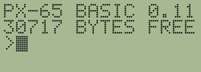
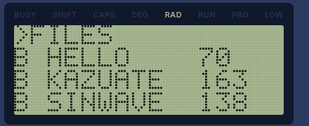
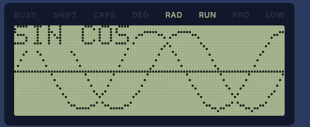
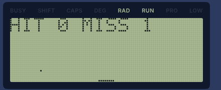

# PX-65 Getting Started

[日本語](guide.md) | English

The PX-65 is an imaginary pocket computer built around the 65C02, an 8-bit CPU. When you turn it on, BASIC starts, and you can calculate right away or write and run programs. The screen shows 16 characters × 4 lines (96 × 32 dots), and you can draw dots and lines and play sounds.

This guide walks you from starting the emulator to running and saving a program. For the full details, see the manuals listed in "Learn more" at the end.

## 1. Start it

Double-click `dist/px65-en.html` (Japanese version: `dist/px65.html`) to open it in your browser. Nothing to install, and no internet connection is needed.



You see `PX-65 BASIC 0.11` (0.11 is the BASIC version) and the amount of free memory (30717 bytes). The `>` below them means it is waiting for you to type.

- Sound starts after you click the page once (browsers require this)
- Phones often can't open a downloaded HTML file directly. Put the file on a web server (such as GitHub Pages) and open it by its URL

## 2. Type on the keys

Click (or tap) the keys on the screen, or type on your computer's keyboard.

| PX-65 key | Computer keyboard |
| --- | --- |
| RET (enter the line) | Enter |
| DEL (delete a character) | Backspace |
| BRK (stop the program) | Esc |
| ↑ (bring back the last line you typed) | ↑ |

- Letters come out in upper case
- On your computer's keyboard, just type symbols as usual (including `"` and `:`)
- To type a symbol with the on-screen keys, press SHIFT, then the key that has the symbol printed small in its top-right corner. For example, `:` is SHIFT → `×`, and `"` is SHIFT → `2`
  - SHIFT applies to the next key only. While it is active, SHIFT lights on the LCD and the SHIFT key looks pressed. To cancel, press SHIFT again
  - Uncheck **SHIFT for the next key only** below the screen to make SHIFT work only while you hold it down (like a real keyboard; on a phone, press both keys with two fingers)
  - The Shift key on your computer's keyboard always works while held down, whichever way is set
- On a phone held upright, the **123** and **ABC** keys switch between the number keys and the letter keys

## 3. Do some math

Type `PRINT` followed by an expression and press RET to see the answer right away. You can write `?` instead of `PRINT`.

```
>PRINT 1+2
 3
>?SQR(2)
 1.41421356
>?2^10, 7/3
 1024    2.33333333
```

A command typed without a line number runs immediately like this (direct mode).

For calculator-style work, type `CALC` to enter calculator mode. The prompt changes to `C>`, and an expression alone gives the answer, without `PRINT`. Press BRK (Esc on a computer) to leave.

```
>CALC
C>100/7
 14.2857143
C>R=5
C>PI*R^2
 78.5398163
```

In calculator mode, a line starting with a number is also an expression (you can't type program lines). A line starting with "variable=", such as `R=5`, is an assignment. For details, see "CALC (calculator mode)" in `docs/basic.en.md`.

## 4. Your first program

A line typed with a line number is not run right away. It is stored as part of your program.

```
>10 FOR I=1 TO 5
>20 PRINT I;I*I
>30 NEXT
>RUN
 1  1
 2  4
 3  9
 4  16
 5  25
```

- `RUN` runs the program. If it doesn't stop, press BRK (Esc on a computer)
- `LIST` shows the program. When the screen fills up, it waits for a key; press RET to see more
- Typing a line again with the same number replaces it. Typing just a line number deletes that line
- `EDIT 20` puts line 20 in the input line so you can fix it. Move the cursor with ← →, delete with DEL or type to insert, then press RET
- `NEW` erases the whole program and all variables
- `RENUM` renumbers the lines as 10, 20, 30, …

## 5. Draw pictures and play sounds

The top-left corner of the screen is (0,0), and the bottom-right is (95,31).

```
>CLS:CIRCLE 48,16,12:LINE 0,31,95,0
>BEEP 880,50
```

- `PSET x,y` draws a dot, `LINE x1,y1,x2,y2` a line, and `CIRCLE x,y,radius` a circle
- `BEEP frequency,length` plays a sound (length in 1/100 seconds)
- `CLS` clears the screen

## 6. Run the samples

`samples/samples.tap` holds seven programs you can play with right away.

1. Press **Insert tape** below the screen and choose `samples/samples.tap`
2. Type `FILES` to list the programs on the tape (press RET to see more)
3. Load one by name, like `LOAD "SINWAVE"`, and type `RUN`



| Name | What it does | How to play / what to look at |
| --- | --- | --- |
| HELLO | Asks your name and says hello | Type your name and press RET |
| KAZUATE | Number guessing game ("kazuate" is Japanese for "guess the number") | Guess a number from 1 to 100. `UP` means higher, `DOWN` means lower |
| SINWAVE | Graphs of SIN and COS | Press any key when it finishes drawing |
| BOUNCE | A bouncing ball | Beeps at the walls. Press BRK to stop |
| MUSIC | Plays "Twinkle Twinkle Little Star" | Reads pitches and lengths with `READ` and `DATA` |
| CATCH | Catch the falling dots | Move the bar with ← →. The game ends after three misses |
| ABC | Writes machine code with `POKE` and runs it with `CALL` | Prints A to Z |





`LIST` shows what is inside a program. The same programs are also in `samples/` as `.bas` text files. Try changing them.

## 7. Save your program

The PX-65 saves programs on a virtual cassette tape.

1. Type `SAVE "MYPROG"` to save the current program on the tape (names can be up to 8 characters)
2. Press **Save tape** below the screen to save the tape as a file (`.tap`) on your computer
3. Next time, choose that file with **Insert tape** and load the program with `LOAD "MYPROG"`

- The tape stays after you close the page (the browser remembers it), but saving important work as a file with **Save tape** is safer
- Saving always adds to the end of the tape. If you save under the same name more than once, `LOAD "NAME"` reads the one saved last (`LOAD` without a name reads the first program on the tape)
- To empty the tape, press **Eject tape**. When the tape is full (64KB), `SAVE` gives `?TF ERROR`

## 8. If something goes wrong

| Problem | What to do |
| --- | --- |
| The program won't stop | Press BRK (Esc on a computer) |
| The screen is a mess | Type `CLS` |
| Nothing responds | Press **Reset**. Your program stays (variables are cleared) |
| You see something like `?SN ERROR IN 30` | Line 30 has a mistake. Look at it with `LIST 30` and fix it. The kinds of errors are listed in the "Errors" table in `docs/basic.en.md` |
| The program was gone after turning the power off | **Keep RAM when powered off** is unchecked. Check it to keep the program (it is checked at first) |
| You want to erase the program and all variables | Type `NEW` to erase the BASIC program and its variables. To clear all of memory and start again, press **Clear RAM** (the tape is kept) |
| You want to keep everything exactly as it is now | Press **Save state**. **Load state** takes you back to that moment (one saved state only) |
| No sound | Click the page once. Check that **Sound** is checked. On an iPhone, turn off silent mode |

## 9. Learn more

- `docs/basic.en.md`: the BASIC manual (every command and function, errors, limits)
- `docs/monitor.en.md`: the monitor manual. The monitor is a program for working with machine code (view and change memory, assemble, run one instruction at a time). Type `MON` in BASIC to enter it, and `Q` to go back to BASIC
- `docs/PX-65_spec.md`: the PX-65 hardware specification (memory map, I/O, keyboard layout; Japanese only)
- `README.en.md`: how to use the emulator, and information for developers
