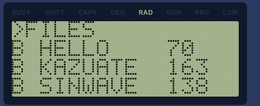
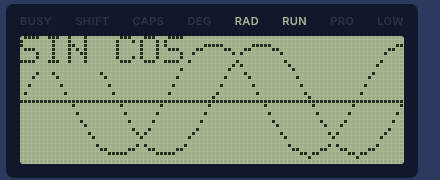
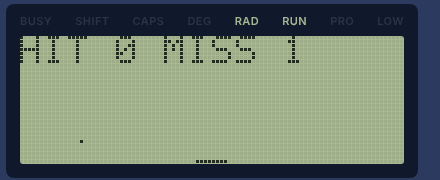

# PX-65 はじめてガイド

日本語 | [English](guide.en.md)

PX-65 は、65C02 という8ビットのCPUを積んだ、架空のポケットコンピューターです。電源を入れると BASIC が動き、その場で計算したり、プログラムを書いて動かしたりできます。画面は16文字×4行(96×32ドット)で、点や線の絵を描いたり、音を鳴らしたりもできます。

このガイドでは、起動してから、プログラムを動かして保存するまでを順に説明します。くわしい説明は最後の「もっと知る」にある説明書を見てください。

## 1. 起動する

`dist/px65.html`(英語版は `dist/px65-en.html`)をダブルクリックして、ブラウザで開きます。インストールもインターネットも要りません。


`PX-65 BASIC 0.11`(0.11 は BASIC のバージョン)と、使えるメモリの大きさ(30717 バイト)が出て、その下の `>` が入力を待っている印です。

- 音は、ページを一度クリックすると鳴るようになります(ブラウザの決まりです)
- スマートフォンでは、ダウンロードしたHTMLを直接開けないことが多いので、Webサーバー(GitHub Pages など)に置いてURLで開きます

## 2. キーを打つ

画面のキーをクリック(タップ)するか、PCのキーボードで打ちます。

| PX-65 のキー | PCのキーボード |
| --- | --- |
| RET(入力の確定) | Enter |
| DEL(1文字消す) | Backspace |
| BRK(プログラムを止める) | Esc |
| ↑(直前に打った行をもう一度出す) | ↑ |

- 英字は大文字で入ります
- 記号は、PCのキーボードからはそのまま打てます(`"` や `:` も)
- 画面のキーで記号を打つには、SHIFT を押してから、キーの右上に小さく書いてある記号のキーを押します。たとえば `:` は SHIFT → `×`、`"` は SHIFT → `2` です
  - SHIFT は次の1文字だけ効きます。効いている間は、液晶の SHIFT が点き、SHIFT キーが押された形になります。打つのをやめるときは、もう一度 SHIFT を押します
  - 画面の下の「SHIFTは次の1文字だけ」のチェックを外すと、SHIFT を押している間だけ効く方式になります(実際のキーボードと同じ。スマートフォンでは2本の指で同時に押します)
  - PCのキーボードの Shift は、どちらの方式でも押している間だけ効きます
- スマートフォンの縦持ちでは、「123」「ABC」のキーで文字キーと数字キーを切り替えます

## 3. 計算してみる

`PRINT` のあとに式を書いて RET を押すと、すぐに答えが出ます。`PRINT` は `?` と短く書けます。

```
>PRINT 1+2
 3
>?SQR(2)
 1.41421356
>?2^10, 7/3
 1024    2.33333333
```

このように、行番号を付けずに打った命令はすぐに実行されます(直接実行)。

電卓のように続けて計算するなら、`CALC` と打って計算モードにすると便利です。プロンプトが `C>` に変わり、`PRINT` を付けずに式だけで答えが出ます。やめるときは BRK(PCでは Esc)を押します。

```
>CALC
C>100/7
 14.2857143
C>R=5
C>PI*R^2
 78.5398163
```

計算モードでは、数で始まる行も式になります(プログラムの行は打てません)。`R=5` のように「変数=」で始まる行は代入です。詳しくは `docs/basic.md` の「CALC(計算モード)」を見てください。

## 4. はじめてのプログラム

行番号を付けて打つと、すぐには実行されずにプログラムとして覚えます。

```
>10 FOR I=1 TO 5
>20 PRINT I;I*I
>30 NEXT
>RUN
 1  1
 2  4
 3  9
 4  16
 5  25
```

- `RUN` で実行します。止まらないときは BRK(PCでは Esc)で止めます
- `LIST` でプログラムを表示します。画面がいっぱいになるとキーを待つので、RET で続きを見ます
- 同じ行番号で打ち直すと、その行が置き換わります。行番号だけを打つと、その行を消します
- `EDIT 20` で20行を入力欄に出して直せます。← → でカーソルを動かし、DEL で消したり、文字を打って入れたりして、RET を押します
- `NEW` でプログラムと変数を全部消します
- `RENUM` で行番号を 10, 20, 30, … に振り直します

## 5. 絵を描く・音を出す

画面の左上が (0,0)、右下が (95,31) です。

```
>CLS:CIRCLE 48,16,12:LINE 0,31,95,0
>BEEP 880,50
```

- `PSET x,y` で点、`LINE x1,y1,x2,y2` で線、`CIRCLE x,y,半径` で円を描きます
- `BEEP 周波数,長さ` で音を出します(長さは1/100秒単位)
- `CLS` で画面を消します

## 6. サンプルを動かす

`samples/samples.tap` に、すぐに遊べるプログラムが7本入っています。

1. 画面の下の「テープを入れる」を押して、`samples/samples.tap` を選びます
2. `FILES` と打つと、テープに入っているプログラムの一覧が出ます(RET で続き)
3. `LOAD "SINWAVE"` のように名前を書いて読み込み、`RUN` で動かします



| 名前 | 内容 | 遊び方・見どころ |
| --- | --- | --- |
| HELLO | 名前を聞いてあいさつする | 名前を打って RET |
| KAZUATE | 数あてゲーム | 1〜100 の数を当てる。`UP` なら大きく、`DOWN` なら小さく |
| SINWAVE | SIN と COS のグラフ | 描き終わったら何かキーを押す |
| BOUNCE | ボールが跳ね回る | 壁で音が鳴る。BRK で止める |
| MUSIC | 「きらきら星」を演奏する | `READ` と `DATA` で音の高さと長さを読む |
| CATCH | 落ちてくる点を受け止めるゲーム | ← → でバーを動かす。3回落とすと終わり |
| ABC | 機械語を `POKE` で書き込み、`CALL` で動かす | A〜Z を表示する |





プログラムの中身は `LIST` で見られます。同じものが `samples/` に `.bas` のテキストファイルとしても入っています。書き換えて遊んでみてください。

## 7. 作ったプログラムを保存する

PX-65 は、プログラムを仮想のカセットテープに保存します。

1. `SAVE "MYPROG"` と打つと、今のプログラムがテープに保存されます(名前は8文字まで)
2. 画面の下の「テープを保存」を押すと、テープの中身をファイル(`.tap`)として自分のPCに保存できます
3. 次に使うときは「テープを入れる」でそのファイルを選び、`LOAD "MYPROG"` で読み込みます

- テープはページを閉じても残ります(ブラウザが覚えています)が、大事なものは「テープを保存」でファイルにしておくと安心です
- 保存はいつもテープの最後に足されます。同じ名前で何度か保存すると、`LOAD "名前"` は最後に保存したものを読みます(名前を省いた `LOAD` は、テープの最初のプログラムを読みます)
- テープを空にするには「テープを取り出す」を押します。テープがいっぱい(64KB)になると、`SAVE` は `?TF ERROR` になります

## 8. 困ったとき

| こんなとき | すること |
| --- | --- |
| プログラムが止まらない | BRK(PCでは Esc)を押す |
| 画面がごちゃごちゃになった | `CLS` と打つ |
| 何を押しても反応しない | 「リセット」を押す。プログラムは消えない(変数は消える) |
| `?SN ERROR IN 30` などと出た | 30行に間違いがある。`LIST 30` で見て直す。エラーの種類は `docs/basic.md` の「エラー」の表にある |
| 電源を切ったらプログラムが消えた | 「電源を切ってもRAMを残す」がオフになっている。オンにしておくと残る(初めはオン) |
| プログラムも変数も全部消したい | `NEW` と打つと、BASIC のプログラムと変数が消える。メモリ全体を消して起動し直すなら「RAMを消去」を押す(テープは消えない) |
| 今の状態をそのまま取っておきたい | 「状態を保存」を押す。「状態を読み込む」でその時点に戻れる(1つだけ) |
| 音が鳴らない | ページを一度クリックする。「音」のチェックを確かめる。iPhone ではマナーモードを切る |

## 9. もっと知る

- `docs/basic.md`: BASIC の説明書(すべての命令と関数、エラー、制限)
- `docs/monitor.md`: モニターの説明書。BASIC で `MON` と打つと入れる、機械語を扱うためのプログラム(メモリの表示と書き込み、アセンブル、1命令ずつの実行)。`Q` で BASIC に戻る
- `docs/PX-65_spec.md`: PX-65 の仕様(メモリの使い方、I/O、キーボードの配置)
- `README.md`: エミュレーターの使い方と、開発する人向けの情報
